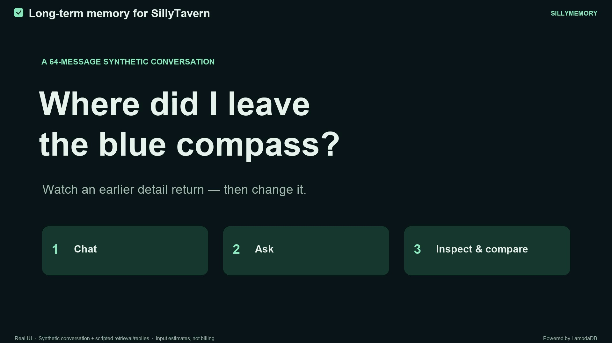

# SillyMemory

Long-term memory for SillyTavern. **Powered by LambdaDB.**

SillyMemory keeps your recent dialogue in the prompt and brings back relevant
older passages from the same chat, so long conversations stay coherent without
sending the whole history on every request. Original messages are never
rewritten. You can see which passages were used for each reply.

**Experimental pre-release.** Start with a test chat. See
[GitHub Releases](https://github.com/lambdadb/SillyMemory/releases) and the
[CHANGELOG](CHANGELOG.md) for version details.

## Demo

[](https://github.com/user-attachments/assets/8a34772d-b27f-4709-89c0-caee45c7fcf6)

[Watch the demo (2:05, no audio)](https://github.com/user-attachments/assets/8a34772d-b27f-4709-89c0-caee45c7fcf6):
memory recall, source inspection, input token comparison and separate
conversation branches. The recording uses real UI with synthetic dialogue and
scripted replies; token figures are host estimates, not billing.

## Quick start

You need **SillyTavern 1.19.0** opened on `localhost` or over HTTPS, with Git on
its host and a working chat model connection. Chromium is the tested browser.

### 1. Install the extension

In SillyTavern, open **Extensions → Install extension**, paste the repository
URL and confirm the third-party extension prompt:

```text
https://github.com/lambdadb/SillyMemory
```

Leave the branch field empty to follow `main`. Reload the page afterwards.

### 2. Connect to LambdaDB

Open **Extensions → SillyMemory** and click **Connect to LambdaDB**. Sign up or
log in in the window that opens, choose or create a project, and approve the
connection. The window closes by itself.

SillyMemory then runs a short setup test with temporary data and shows
**Connected to \<project\>**. Your chat is not uploaded, and memory stays off
until you turn it on in a chat.

LambdaDB's [Free plan](https://lambdadb.ai/pricing) needs no credit card. Your
chat model provider's charges are separate.

### 3. Turn memory on in a chat

1. Open a plain-text character or group chat, new or existing.
2. If you use the built-in **Vector Storage** extension, turn off its chat
   vectorization. SillyMemory pauses while it is on.
3. Expand **Memory** above the message composer and click
   **Turn memory on in this chat**.
4. Wait until the status shows **Ready**, then chat as usual.

On first activation SillyMemory indexes the chat's older messages; a long
history takes longer and uses more of your LambdaDB allowance. After that,
every reply retrieves relevant passages automatically. Open **Last prompt** in
the Memory panel to see the passages that were selected, or **View full
memory** for everything that was added to the prompt.

## How it works

- The latest five messages always stay in the prompt, without splitting your
  latest message from its replies or a group's round of member replies. Older
  messages are saved
  as memory in your LambdaDB project. Before each reply, SillyMemory searches
  that memory with the current message and adds related passages within a
  **memory token budget** (default 4,096 tokens, at most one quarter of the
  context size; change it under **Advanced**).
- **Text search languages** in settings offers checkboxes for the LambdaDB text analyzers
  (default `english`) for story memory created after the change. Pick only the
  languages you chat in; each analyzer indexes the text again. A story created
  with a different setting shows **Rebuild story memory** in its Memory panel,
  which deletes that story's memory for every branch and uploads it again from
  your local chats.
- **Text-private memory** (opt-in, in settings) keeps raw text out of
  LambdaDB: your browser turns older messages and queries into vectors through
  an embedding endpoint you choose, LambdaDB stores only vectors and metadata,
  and recalled passages come from your local chat. Recommended models,
  validated on English LongMemEval-S only: local Ollama `qwen3-embedding:0.6b`
  or the lighter `embeddinggemma`, or OpenAI `text-embedding-3-small`. Other
  models work but their quality is not validated. It applies to stories created
  after the change; **Rebuild story memory** converts an existing story. Search
  uses vectors only, without reranking. See
  [text-private mode](docs/text-private-mode.md).
- Memory is per chat. **Turn memory off in this chat** returns that chat to
  ordinary SillyTavern history handling; the saved memory is kept. New chats
  start with memory off.
- Edits, swipes and deletions are reconciled on the next sync. Files, tool
  messages, Data Bank and World Info are not indexed.
- In a group chat, memory belongs to the group chat, not to a member. Each
  member's reply searches memory with your latest message, so one message
  answered by three members makes three searches. Adding or removing members
  keeps the chat's memory.
- SillyTavern's **Save checkpoint**, **Create Branch** and **Back to parent
  chat** work as usual. Memory follows whichever chat you open, and linked
  branches reuse the history they share.
- After a reload SillyMemory reconnects with the saved key and restores each
  chat's on/off choice.

In the recorded 500-question LongMemEval-S evaluation, SillyMemory answered
**96.0%** correctly versus **95.2%** for full history, with **95.35% less**
mean answer input, and our
[published cost estimate](https://lambdadb.ai/blog/ai-memory-fewer-tokens-without-graphs#the-cost-of-remembering)
was about 91–93% lower than full history. Unlike summarization, SillyMemory
makes no generative LLM calls to maintain memory. See the
[comparison report](docs/longmemeval-public-evaluation.md) for the tested
configurations and their limits; these results describe English benchmark chats,
not a guarantee for every model or roleplay.

## If something goes wrong

| What you see | What to do |
| --- | --- |
| Connection or authentication failure | Click **Reconnect** in the Memory panel. If it keeps failing, open **SillyMemory settings → Connection**, use **Disconnect** or **Forget key**, then connect again. |
| Setup test failed | Click **Clean up test data**, then **Run setup test** in settings. |
| Synchronization failure | Follow the status message, then click **Retry synchronization** in the Memory panel. Synchronization also runs again on the next message, edit or chat change. |
| Reply stopped while adding memory | Read the status, fix the cause, then click **Retry reply** or use SillyTavern's **Regenerate**. In a group, Regenerate redoes the whole round; to get only a missing member's reply, use **Trigger a message from this character** next to that member in the group panel. If Auto Mode was on, it is turned off; turn it on again after fixing the cause. When the reply stopped because recent messages or memory were left out, send a message first: the earlier Auto Mode replies then move into memory. After SillyTavern's own **Stop** button, send a message before turning Auto Mode on again (a SillyTavern limitation). Only a request LambdaDB rejected with HTTP 429 is retried automatically, at most twice within the same 15-second request deadline. |
| LambdaDB is busy or over its request limit (HTTP 429) | Each LambdaDB project has a request budget of `rate_limit` requests per second (5 by default), refilled at that rate. The extension waits as long as the response's `Retry-After` header says (one second for the default limit) and retries twice, so this status normally clears itself; if it persists, check the project's `rate_limit` in the LambdaDB console project overview and raise it through a support request. |
| Query exceeds 8 KiB | Shorten the latest messages, or turn memory off for that reply. |
| Embedding request failed (text-private memory) | Check that the embedding endpoint is running and the URL and model are right, then **Test endpoint** in settings. Ollama allows SillyTavern on the same machine by default; for another device, see [setup and recovery](docs/setup-and-recovery.md#text-private-memory). |
| Story created with a different memory mode or embedding model | Click **Rebuild story memory** in the Memory panel, or change the setting back. |

## Data, usage and deletion

Older chat text, timestamps and search queries go directly from your browser to
your LambdaDB project, where LambdaDB's embedding and reranking providers process
them. With **Text-private memory**, raw text is not sent to or stored in
LambdaDB: older messages and queries go to your embedding endpoint (with a local
endpoint, text stays on this machine), and LambdaDB receives vectors,
timestamps, speaker names and other metadata. Storage, writes, searches and inference count toward your
[LambdaDB plan](https://lambdadb.ai/pricing). Turning memory off keeps the saved
memory, so on Pay as You Go it continues to use storage until deleted.

- **Delete this chat's memory** is under **This chat's memory** in that chat's
  Memory panel. It removes only that chat's memory and turns memory off there.
- **Delete all memory** is under **Advanced** in settings. Use it before
  uninstalling the extension; deleting a chat in SillyTavern or removing the
  extension does not delete its memory.
- **Disconnect** (in **Connection**) removes the project key from this browser
  and turns memory off; the memory itself is kept. To switch projects, delete
  all memory first.

The project key, and an optional embedding key, are saved in browser storage scoped to your SillyTavern account.
Other extensions on the same page can read browser storage; it is not an
isolated vault. See [saved connections](docs/saved-connection.md) and
[storage and recovery](docs/versioned-memory.md) for details.

## Manual connection

If you prefer not to use Connect, create a project in the
[LambdaDB Console](https://app.lambdadb.ai/), create a project API key on its
**API Keys** tab, and enter the regional HTTPS endpoint, project name and key
under **Connection** in SillyMemory settings. Click **Connect and test**. The
rest of the flow is the same.

## Current limits

- Experimental: retrieved memory does not guarantee a correct answer.
- Plain-text character and group chats only. Files and tool conversations are
  outside the supported path.
- Group-chat answer quality is not evaluated; the recorded benchmark results
  cover single-character dialogue only.
- Group Auto Mode without your input keeps every reply since your last message
  in the prompt. A long run can outgrow the context: with **Stop on missing
  context** on (the default) the reply stops and Auto Mode turns off. Send a
  message to continue: the earlier rounds of the run then move into memory and
  only the last rounds stay in the prompt.
- Live reply and streaming checks cover OpenAI `gpt-6.1-sol` on SillyTavern
  1.19.0 and Chromium; other models, providers and browsers are unverified.
- Prompt delivery is checked for Chat Completion; other formats may report
  verification unavailable.
- Use one SillyMemory tab per browser profile. Editing the same memory from two
  devices at once is unsupported.
- Requests share the LambdaDB project's rate limit (5 requests per second by
  default). Turning memory on in a chat with a long history can briefly exceed
  it; the automatic 429 retry absorbs this with one-second waits.

## Updating

In **Extensions → Manage extensions**, use SillyMemory's **Update** button and
reload. Updates follow the installed Git branch (`main` by default), not the
newest release tag. Settings and memory are preserved; do not delete memory
just to update.

- From 0.7.x: chats that had memory on come up off; open each one and choose
  **Turn memory on in this chat** again (saved memory is reused). The optional
  **Frozen memory snapshots** feature was removed; use SillyTavern's native
  checkpoints and branches instead. Chats that were saved as snapshots have no
  migration path.
- From 0.6.0: open each chat and choose **Turn memory on in this chat**; the
  global switch was replaced by per-chat choices.

## Development

See [CONTRIBUTING](CONTRIBUTING.md) for development and validation commands,
[architecture](docs/architecture.md) for implementation details, the
[development reference](docs/development.md) for test entry points, and
[benchmark/](benchmark/) for the LongMemEval-S and BEAM settings and results.

## License

Copyright (C) 2026 SillyMemory contributors.
Licensed under [GNU AGPL-3.0-only](LICENSE), without warranty.
Bundled dependencies retain their [third-party licenses](vendor/LICENSES.txt).
